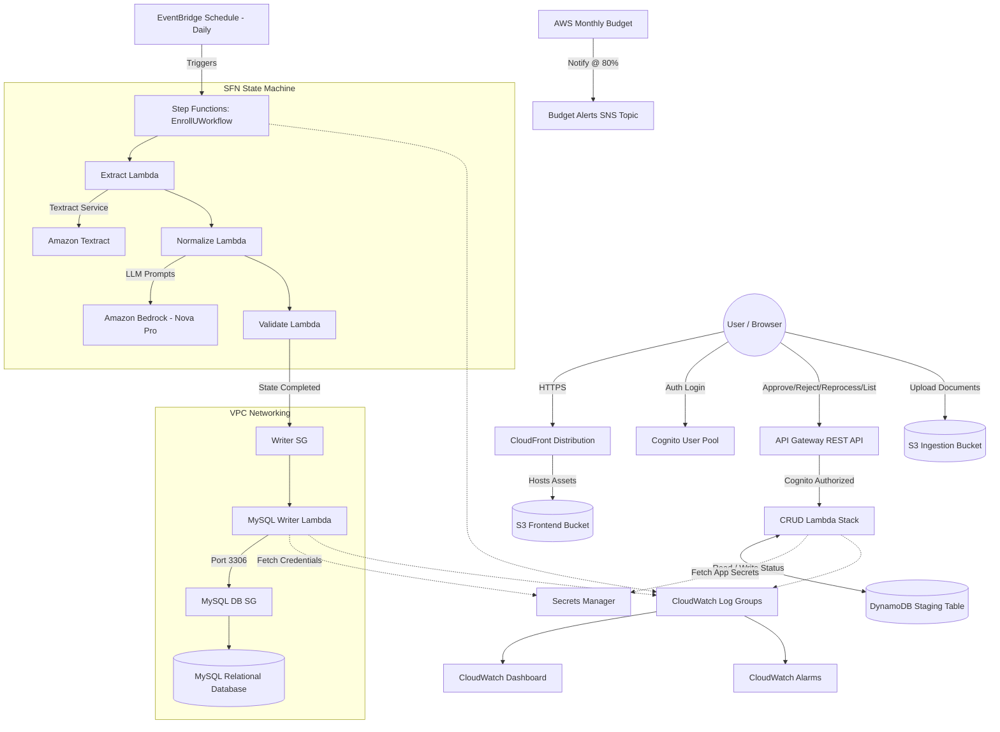

# Architecture Report

This document provides a comprehensive overview of the architecture, file structure, and Lambda services of the **Enroll-U** platform.

---

## 1. Directory & File Structure Analysis

The project is structured as a mono-repo combining the backend Infrastructure-as-Code (AWS CDK in TypeScript), serverless Python microservices (AWS Lambda), and a placeholder React frontend.

```
enrollu_aws/
├── bin/
│   └── enroll-u.ts                     # CDK application entry point
├── lib/
│   └── constructs/
│       ├── account-stack.ts            # AWS Budget Alerts and SNS topic
│       ├── apigateway-stack.ts         # REST API Gateway & Cognito Authorizer
│       ├── bedrock-stack.ts            # Amazon Bedrock IAM permission configuration
│       ├── cloudfront-stack.ts         # Static website hosting (S3 + CloudFront)
│       ├── cognito-stack.ts            # Cognito User Pool & client configuration
│       ├── database-stack.ts           # VPC Database networking & MySQL Writer Lambda
│       ├── dynamodb-stack.ts           # DynamoDB Staging Table
│       ├── eventbridge-stack.ts        # Cron / Schedule rule for State Machine execution
│       ├── iam-stack.ts                # IAM Role constructs (Step Functions role)
│       ├── index.ts                    # Exports index of constructs
│       ├── lambda-stack.ts             # Core Lambda stack (7 API / Workflow functions)
│       ├── monitoring-stack.ts         # CloudWatch Log Groups, Alarms, and Dashboard
│       ├── networking-stack.ts         # VPC, Subnets, and Security Groups configuration
│       ├── s3-stack.ts                 # S3 Ingest Bucket
│       ├── secrets-stack.ts            # Secrets Manager credentials (App / Database)
│       ├── stepfunctions-stack.ts      # Step Functions Workflow orchestration (Extract -> Normalize -> Validate)
│       └── textract-stack.ts           # Amazon Textract IAM permission configuration
├── lambdas/
│   ├── crud/                           # Document API endpoints / CRUD Lambdas
│   │   ├── approve.py                  # POST /documents/{id}/approve
│   │   ├── get_documents.py            # GET /documents
│   │   ├── reject.py                   # POST /documents/{id}/reject
│   │   ├── reprocess.py                # POST /documents/{id}/reprocess
│   │   └── requirements.txt
│   ├── extract/                        # Step 1 of Workflow: Textract extraction
│   │   ├── extract.py                  
│   │   ├── requirements.txt
│   │   └── run.py
│   ├── mysql_writer/                   # DB Writer Lambda
│   │   ├── mapper.py
│   │   ├── writer.py
│   │   └── requirements.txt
│   ├── normalize/                      # Step 2 of Workflow: LLM normalization
│   │   ├── normalize.py
│   │   ├── prompt_builder.py
│   │   └── requirements.txt
│   └── validate/                       # Step 3 of Workflow: Rule validation
│       ├── validate.py
│       ├── validators.py
│       └── requirements.txt
├── layers/
│   └── common/                         # Shared utilities/dependencies layer
│       └── requirements.txt
├── frontend/                           # React Frontend Client (scaffold)
│   ├── public/
│   └── src/
│       ├── components/
│       ├── contexts/
│       ├── hooks/
│       ├── pages/
│       └── services/
├── docs/                               # Project documentation
│   ├── api_contracts.md
│   ├── architecture.md                 # Target Architecture
│   ├── cost_estimates.md
│   ├── networking.md
│   └── security.md
├── scripts/                            # Deploy/Teardown utility scripts
│   ├── deploy.sh
│   └── destroy.sh
├── tests/                              # Integration & Unit test suites
│   ├── integration/
│   ├── sample_documents/
│   └── unit/
├── package.json                        # Node dependencies (CDK)
└── tsconfig.json                       # TypeScript compiler options
```

---

## 2. Platform Architecture Overview

The **Enroll-U** platform follows a event-driven serverless architecture designed to ingest, extract, normalize, validate, and store document metadata securely. The architecture is broken into five core functional blocks:

1. **Client & Ingestion Layer**: 
   - A static frontend hosted in S3 is served globally via a **CloudFront** CDN.
   - User identity, signup, and API access are authenticated through **Cognito User Pools**.
   - Raw documents are uploaded to an **S3 Ingestion Bucket** (configured with SSL enforcement and S3-managed encryption).

2. **API & Staging Layer (Synchronous/CRUD)**:
   - **API Gateway (REST)** exposes Cognito-authorized routes to manage and query state.
   - CRUD Lambdas interact directly with the **DynamoDB Staging Table** (`EnrollUStaging`) to list records or change document status (Approve, Reject, Reprocess).

3. **Orchestration & Document Processing Layer (Asynchronous/Workflow)**:
   - An **EventBridge Rule** schedules a daily execution of an **AWS Step Functions** state machine (`EnrollUWorkflow`).
   - The State Machine coordinates a sequential data pipeline using three Lambda functions:
     1. **Extract**: Extracts raw text and forms using **Amazon Textract**.
     2. **Normalize**: Takes text and structures/cleans it using LLM models via **Amazon Bedrock** (specifically `amazon.nova-pro-v1:0` in `us-west-2`).
     3. **Validate**: Automatically verifies the structured schema against predefined domain validation rules.

4. **Persistence Layer**:
   - The system connects to a **MySQL Relational Database** isolated in a private VPC subnet.
   - **VPC Security Groups** restrict access to the MySQL port (3306), allowing ingress only from the **MySQL Writer Lambda**.
   - Secrets and credentials (like DB password) are managed and dynamically read via **Secrets Manager**.

5. **Operational & Management Layer**:
   - **CloudWatch** creates Log Groups with defined retention (30 days) for all Lambda functions and the Step Functions workflow.
   - Alarms monitor Lambda errors and Step Function execution failures.
   - A unified **CloudWatch Dashboard** (`EnrollUOperations`) visualizes health, latency, error metrics, and workflow success rates.
   - **AWS Budgets** establishes a monthly cost limit ($100 USD) and notifies an **SNS Topic** when 80% threshold is exceeded.

### Architecture Topology Diagram



---

## 3. Lambda Service Catalog

 A total of **8 AWS Lambda Functions** are deployed across the stacks. All functions utilize the **Python 3.12** runtime and share baseline logging capabilities.

| # | Lambda Function Name | Function ID (CDK) | Handler | Folder / Source Path | Trigger / Integration | Subnet / Networking | Key IAM Permissions |
|---|---|---|---|---|---|---|---|
| **1** | `EnrollU-Extract` | `ExtractFunction` | `extract.handler` | [lambdas/extract](file:///c:/Users/nanda/Desktop/enrollu_aws/lambdas/extract) | Step Functions (`ExtractTask`) | Default (Non-VPC) | Textract API Access (`textract:*`), Read/Write on Ingest S3 bucket, DynamoDB Staging Table, Secrets Manager |
| **2** | `EnrollU-Normalize` | `NormalizeFunction` | `normalize.handler` | [lambdas/normalize](file:///c:/Users/nanda/Desktop/enrollu_aws/lambdas/normalize) | Step Functions (`NormalizeTask`) | Default (Non-VPC) | Bedrock Converse/Invoke model on `amazon.nova-pro-v1:0` in `us-west-2`, DynamoDB Table |
| **3** | `EnrollU-Validate` | `ValidateFunction` | `validate.handler` | [lambdas/validate](file:///c:/Users/nanda/Desktop/enrollu_aws/lambdas/validate) | Step Functions (`ValidateTask`) | Default (Non-VPC) | Read/Write on DynamoDB Staging Table, CloudWatch logs |
| **4** | `EnrollU-GetDocuments` | `GetDocumentsFunction` | `get_documents.handler` | [lambdas/crud](file:///c:/Users/nanda/Desktop/enrollu_aws/lambdas/crud) | API Gateway (`GET /documents`) | Default (Non-VPC) | DynamoDB Table Read, Secrets Manager Read |
| **5** | `EnrollU-Approve` | `ApproveFunction` | `approve.handler` | [lambdas/crud](file:///c:/Users/nanda/Desktop/enrollu_aws/lambdas/crud) | API Gateway (`POST /documents/{id}/approve`) | Default (Non-VPC) | DynamoDB Table Read/Write, Secrets Manager Read |
| **6** | `EnrollU-Reject` | `RejectFunction` | `reject.handler` | [lambdas/crud](file:///c:/Users/nanda/Desktop/enrollu_aws/lambdas/crud) | API Gateway (`POST /documents/{id}/reject`) | Default (Non-VPC) | DynamoDB Table Read/Write, Secrets Manager Read |
| **7** | `EnrollU-Reprocess` | `ReprocessFunction` | `reprocess.handler` | [lambdas/crud](file:///c:/Users/nanda/Desktop/enrollu_aws/lambdas/crud) | API Gateway (`POST /documents/{id}/reprocess`) | Default (Non-VPC) | DynamoDB Table Read/Write, Secrets Manager Read |
| **8** | `EnrollU-MySqlWriter` | `MysqlWriterFunction` | `writer.handler` | [lambdas/mysql_writer](file:///c:/Users/nanda/Desktop/enrollu_aws/lambdas/mysql_writer) | Downstream / Event Handler | VPC Private Subnets with custom Security Group | VPC Access execution, MySQL Port 3306 egress, MySQL Secrets Manager Read |

### Lambda Code Layers
To share code and packages, the infrastructure configures two custom CDK Lambda layers:
* `sharedWorkflowLayer` (scoped to `./lambdas/extract` directory assets) associated with `Extract`, `Normalize`, and `Validate` functions.
* `sharedCrudLayer` (scoped to `./lambdas/crud` directory assets) associated with `Approve`, `Reject`, `Reprocess`, and `GetDocuments` functions.

---

## 4. Stack-by-Stack Analysis (CDK Constructs)

The infrastructure definition in `bin/enroll-u.ts` instantiates **16 separate stacks**, creating a highly modular deployment graph:

* **NetworkingStack**: Provisions the VPC spanning 2 Availability Zones containing Public and Private Isolated Subnets, alongside the writer Lambda security group.
* **S3Stack**: Provisions the primary ingestion bucket with secure configurations (SSL, managed KMS encryption, auto-delete lifecycle policy).
* **DynamoDBStack**: Deploys the staging DynamoDB table `EnrollUStaging` with standard point-in-time recovery enabled.
* **SecretsStack**: Generates and manages dynamic passwords/tokens for relational database login and application access credentials.
* **IAMStack**: Sets up foundational roles, specifically standard IAM trust policies allowing Step Functions to orchestrate tasks.
* **LambdaStack**: Packs layer definitions, sets environment configurations, instantiates the core 7 lambda functions, and manages baseline IAM execution policies.
* **TextractStack**: Grants inline Textract execution permissions to the main Lambda execution role.
* **BedrockStack**: Configures Converse and Invoke policies on US West 2 Nova Foundation models for the Lambda execution role.
* **StepFunctionsStack**: Assembles the standard SFN execution definition (`extract` -> `normalize` -> `validate`) with retry logic for API reliability.
* **EventBridgeStack**: Schedules a recurring daily rate trigger pointing directly to the SFN state machine target.
* **CognitoStack**: Instantiates Cognito Identity Provider User Pool and OAuth Client for secured web access.
* **ApiGatewayStack**: Constructs REST endpoints, sets up CORS headers, and registers the Cognito User Pool Authorizer.
* **CloudFrontStack**: Spins up an S3 hosting bucket and maps it to a CloudFront CDN to serve web frontend files.
* **DatabaseStack**: Builds database-specific network rules (ingress from Lambda writer security group) and provisions the `mysqlWriterFn` directly inside the private subnets.
* **MonitoringStack**: Automatically provision log groups for execution diagnostics, registers three CloudWatch metric alarms (Extract errors, State Machine failures, MySQL Writer errors), and hosts a telemetry Dashboard.
* **AccountStack**: Attaches AWS Budgets to alert on monthly cost metrics to prevent unexpected cloud expenditure.
